# 🌈 Pelangi Elektronik — Sistem Stok, Pembelian & Penjualan (Laravel 13)

Aplikasi web **Inventory & Sales Management** untuk usaha distribusi/toko elektronik: produk, kategori, pemasok, gudang, pembelian (stok masuk), penjualan toko, pesanan online pelanggan, pembukuan otomatis, dashboard berperiode, laporan cetak/CSV, serta REST API dan webhook. Dikembangkan dari project **StockFlow Blue** (struktur, tabel, dan class lama dipertahankan) untuk UTS *Integrated Laravel Project* — Sistem Informasi, Universitas Malikussaleh.

**Tepat tiga role:** **Owner** (pengelola penuh, setara Owner di PPT), **Staff**, dan **Pelanggan**. Seluruh antarmuka berbahasa Indonesia.

---

## 0. Ringkasan Pengembangan

**Identitas & tampilan:** nama *Pelangi Elektronik* di semua halaman; logo busur pelangi + petir; gradient pelangi (merah-jingga-kuning-hijau-biru-ungu) pada hero, navigasi aktif, tombol utama, strip atas, badge, dan grafik, dengan latar putih/netral agar mudah dibaca. Etalase pelanggan bergaya marketplace (header + pencarian lebar, grid kategori berikon, kartu produk, navigasi bawah di HP), tetapi dengan identitas pelangi sendiri. Tema terang/gelap, responsif laptop–tablet–HP.

**Database:** **SQLite 3** (tanpa XAMPP/MySQL). Berkas `database/database.sqlite` sudah disertakan dan terisi data demo; seluruh tabel tetap dibangun oleh **migration**, dan `php artisan pelangi:setup` membuat/memigrasi/mengisi ulang bila perlu. Foreign key aktif (`DB_FOREIGN_KEYS=true`), transaksi memakai mode `IMMEDIATE` agar dua penjualan bersamaan tidak menghabiskan stok yang sama. MySQL tetap bisa dipakai (opsional, lihat `.env.example`).

**Fitur wajib PPT:** login/logout, role-based access (di server), CRUD kategori/produk/pemasok/pengguna, pembelian & penjualan multi-item dalam satu DB transaction, stok otomatis, pembatalan yang memulihkan stok tepat satu kali, pencarian/filter/pagination, dashboard dari query agregat, validasi & pesan error, soft delete untuk produk yang sudah bertransaksi.

**Fitur tambahan:** kartu stok (ledger), batch/kedaluwarsa (FEFO), PO bertahap (draft → persetujuan → penerimaan), retur penjualan, transfer & stock opname bersetujuan, rekomendasi restock berbasis aturan, deteksi anomali (hanya menandai), notifikasi, audit trail, pengeluaran, riwayat harga, jurnal akuntansi otomatis.

**Gambar produk:** 24 ilustrasi SVG lokal di `public/images/products/` (laptop, smartphone, monitor, keyboard, mouse, headset, printer, speaker, router, flashdisk, kabel, charger, TV, dst.) dipetakan per SKU di seeder, dengan fallback `public/images/no-image.png` dan teks alt. Tanpa hotlink. Ini ilustrasi, bukan foto produk asli.

### Yang selesai vs. terbatas (jujur)
- Tes otomatis (PHPUnit, SQLite in-memory) dijalankan di PHP 8.3 pada lingkungan pengembang; hasilnya lihat bagian Pengujian.
- **Belum diverifikasi:** PHP 8.4 sungguhan, MySQL, build Vite (`npm run build`), dan tampilan visual di peramban (npm tidak terjangkau di lingkungan pengembang). Jalankan `npm install && npm run build` lalu periksa tampilan.
- Proyek memakai **Laravel 13** (bukan 8.14 seperti tertulis di prompt) karena itulah basis StockFlow Blue yang sudah ada; PHP 8.4 diminta pengguna.
- Pembayaran adalah **simulasi**; mata uang hanya tampilan; prediksi stok statistik sederhana; PWA (bukan native); notifikasi hanya internal.
- Data demo dibuat relatif terhadap tanggal pembuatan database; jalankan `php artisan pelangi:setup --fresh` agar grafik "segar" pada tanggal presentasi.

Lihat `PANDUAN-INSTALASI.md` (termasuk `Jalankan-PelangiElektronik.bat`) untuk instalasi dan pemecahan masalah.

---

## 1. Gambaran Umum

| Aspek | Keterangan |
| --- | --- |
| Framework | Laravel 13.x, PHP 8.4+ |
| Frontend | Blade + Tailwind CSS + Alpine.js, Chart.js (grafik) |
| Auth | Laravel Breeze (session) + role-based access (Gate + middleware) |
| Database | SQLite bawaan (file demo disertakan); MySQL/MariaDB didukung lewat `.env` |
| Ekspor | PDF (dompdf), Excel (maatwebsite/excel) |
| Pengujian | PHPUnit — 150 tes feature/unit |

### Fitur wajib (sesuai soal)
Autentikasi · role-based access · CRUD kategori/barang/supplier · pembelian (stok masuk) · penjualan · stok otomatis · pencarian/filter/pagination · dashboard · validasi.

### Fitur tambahan ("tidak wajib" pada soal, tetap dibuat)
| Fitur | Cara kerjanya | Batasan jujur |
| --- | --- | --- |
| Payment gateway | Antarmuka `PaymentGateway` + `SimulatedPaymentGateway`; webhook pembayaran bertanda tangan HMAC-SHA256 | **Simulasi** — tidak ada uang nyata. Kartu berakhiran `0000` selalu ditolak untuk demo |
| Multi-gudang | Tabel `warehouses` + `warehouse_stocks`, transfer stok antar gudang | `barangs.stock` = jumlah seluruh gudang (dijaga `StockService`) |
| Akuntansi sederhana | Jurnal double-entry otomatis (penjualan, pembelian, pelunasan, beban, penyesuaian stok), laba-rugi, neraca saldo, buku besar | Bukan akuntansi lengkap (tanpa pajak, aset tetap, penutupan periode) |
| Aplikasi mobile | REST API `/api/v1` (token Bearer) + aplikasi web **PWA** (bisa di-install, manifest + service worker) | Tidak ada aplikasi native Android/iOS |
| Prediksi stok | Regresi linear atas penjualan mingguan → prediksi permintaan & saran pembelian ulang | **Statistik sederhana, bukan AI/ML**; transparan dan diuji |
| Integrasi ERP | API baca-saja `/api/erp/v1` (API key bertipe `erp`) + webhook keluar bertanda tangan | Tidak terhubung ke ERP tertentu; kontrak API generik |
| Multi-currency | Pilihan mata uang tampilan (IDR, USD, SGD, MYR, EUR), kurs diatur owner | **Hanya tampilan**; semua data tersimpan dalam IDR |

---

## 2. Kebutuhan Sistem

- PHP **8.4+** dengan ekstensi: mbstring, xml, curl, zip, gd, fileinfo, openssl, **pdo_sqlite** (dan `pdo_mysql` bila memakai MySQL)
- Composer 2
- Node.js 20+ dan npm (build Vite)
- Tidak perlu XAMPP/MySQL (SQLite bawaan)

## 3. Instalasi

```bash
cd pelangi-elektronik

composer install
npm install

cp .env.example .env
php artisan key:generate
```

### Konfigurasi `.env`
```dotenv
APP_NAME="Pelangi Elektronik"
APP_URL=http://localhost:8000
APP_LOCALE=id

# Database bawaan: SQLite (berkas database/database.sqlite)
DB_CONNECTION=sqlite
DB_FOREIGN_KEYS=true

# Pembayaran (simulasi). Isi secret acak agar endpoint webhook pembayaran aktif.
PAYMENT_DRIVER=simulated
PAYMENT_WEBHOOK_SECRET=
```
> Hanya `.env.example` yang boleh di-commit. Jangan pernah meng-commit `.env` atau kredensial asli.
> Bawaan: **SQLite**. Membuat berkas kosong manual: `touch database/database.sqlite` (Windows: `type nul > database\database.sqlite`). Untuk MySQL: set `DB_CONNECTION=mysql`, isi `DB_HOST/DB_PORT/DB_DATABASE/DB_USERNAME/DB_PASSWORD` (lihat `.env.example`); `pelangi:setup` membuat database-nya otomatis.

### Migrasi & seeding
```bash
php artisan pelangi:setup        # buat berkas SQLite bila belum ada + migrate + seed bila kosong
# ulang dari nol (hapus semua data lalu isi data demo): php artisan pelangi:setup --fresh
# atau cara standar Laravel: php artisan migrate:fresh --seed
php artisan storage:link
npm run build                   # atau `npm run dev` saat pengembangan
php artisan serve
```
Buka `http://127.0.0.1:8000`.

### Akun demo (password semua: `password`)
| Role | Email | Keterangan |
| --- | --- | --- |
| Owner | `owner@pelangi.test` | Akses penuh |
| Staff | `staff@pelangi.test` | Gudang, pembelian, penjualan (satu role Staff, tanpa pembedaan kasir) |
| Pelanggan | `pelanggan@pelangi.test` | Belanja online (juga `siti@…`, `rahmat@…`) |

Seeder idempoten untuk master data (kategori, supplier, produk memakai `firstOrCreate`); transaksi demo hanya dibuat jika belum ada pembelian.

Seeder membuat data realistis (8 kategori elektronik, 7 pemasok, 27 produk bergambar, 2 gudang, pembelian, penjualan, pesanan pending, pengeluaran, jurnal) melalui **service yang sama dengan aplikasi**, sehingga stok dan pembukuan konsisten. Data seluruhnya dummy.

---

## 4. Fitur per Peran & Matriks Hak Akses

| Fitur | Owner | Staff | Pelanggan |
| --- | :-: | :-: | :-: |
| Dashboard internal (omzet, stok menipis, tren 6 bulan, produk terlaris) | ✅ | ✅ | — |
| Dashboard pelanggan (ringkasan pesanan) | — | — | ✅ |
| Katalog, keranjang, checkout, pembayaran (simulasi), batalkan pesanan *pending* | — | — | ✅ |
| Lihat pesanan milik sendiri | — | — | ✅ (hanya miliknya) |
| Lihat daftar & detail barang, stok menipis, ekspor PDF/Excel | ✅ | ✅ | — |
| Tambah/ubah/hapus barang, kategori, supplier | ✅ | — | — |
| Pembelian (stok masuk) | ✅ buat + batalkan | ✅ buat | — |
| Penjualan toko (POS) & proses pesanan online | ✅ | ✅ | — |
| Batalkan penjualan | ✅ semua yang belum batal | ✅ hanya *pending* dalam cakupannya | ✅ hanya pesanan *pending* miliknya |
| Tandai lunas / pembayaran | ✅ | ✅ | ✅ (pesanannya) |
| Penyesuaian stok, transfer antar gudang, prediksi stok, riwayat transaksi | ✅ | ✅ | — |
| Kelola pengguna | ✅ | — | — |
| Laporan (penjualan, laba-rugi, neraca saldo, buku besar, jurnal) | ✅ | — | — |
| Pengeluaran, mata uang, integrasi (webhook, API key) | ✅ | — | — |
| Invoice PDF | ✅ | ✅ (cakupannya) | ✅ (miliknya) |

Cakupan data: Owner melihat semua; Staff melihat penjualan yang ia buat sendiri + semua pesanan online; Pelanggan hanya miliknya (`Sale::visibleTo`). Aturan ditegakkan **di server** (Gate, middleware `role:`, `authorize()` di FormRequest), bukan hanya disembunyikan di tampilan.

---

## 5. Aturan Bisnis

1. **SKU/kode barang unik**; kode dibuat otomatis (tidak bisa bentrok, juga dengan barang yang sudah di-soft-delete).
2. **Penjualan tidak boleh melebihi stok** — ditolak dengan pesan jelas; stok tidak pernah negatif (dijaga di validasi *dan* di `StockService`).
3. **Total dihitung di server** dari harga di database. `unit_price`/`total` kiriman browser diabaikan.
4. **Database transaction + row lock** (`lockForUpdate`) pada semua operasi stok. Jika satu item gagal, seluruh transaksi di-*rollback* (stok, header, detail, jurnal).
5. **Baris item ganda digabung** sebelum cek stok (tidak bisa mengakali dengan memecah qty).
6. **Pembatalan mengembalikan stok** dan membalik jurnal; pembatalan dua kali tidak mengembalikan stok dua kali.
7. **Pembelian yang stoknya sudah terpakai tidak bisa dibatalkan.**
8. **Barang dengan transaksi tidak dihapus permanen** — memakai *soft delete*; barang dengan stok > 0 tidak bisa dihapus. Kategori/supplier yang masih terpakai tidak bisa dihapus.
9. **Pesanan pelanggan** berstatus *pending* tanpa memotong stok; stok baru berkurang saat staff memproses (*complete*).
10. **Nomor dokumen** diturunkan dari primary key (`SL-`, `PB-`, `TF-`, `JE-`), bebas bentrok walau transaksi bersamaan.
11. **Jurnal selalu seimbang** (debit = kredit); jurnal tidak dihapus, hanya dibalik.
12. **Role tidak bisa diubah lewat mass-assignment** (`role` tidak ada di `$fillable`; hanya owner yang mengubahnya lewat halaman pengguna).

---

## 6. ERD

Gambar: `docs/erd.png` / `docs/erd.svg` (sumber: `docs/erd.mmd`). PK = primary key, FK = foreign key, UK = unique.

```mermaid
erDiagram
    users ||--o{ sales : "pembuat (user_id)"
    users ||--o{ sales : "pelanggan (customer_id)"
    users ||--o{ purchases : "mencatat (user_id)"
    users ||--o{ audit_logs : "melakukan"
    categories ||--o{ barangs : "mengelompokkan"
    categories ||--o{ categories : "sub-kategori (parent_id)"
    suppliers ||--o{ barangs : "pemasok utama"
    suppliers ||--o{ purchases : "memasok"
    warehouses ||--o{ warehouse_stocks : "menyimpan"
    barangs ||--o{ warehouse_stocks : "stok per gudang"
    purchases ||--|{ purchase_items : "berisi"
    barangs ||--o{ purchase_items : "dibeli"
    purchases ||--o{ purchase_receipts : "penerimaan"
    purchase_receipts ||--|{ purchase_receipt_items : "berisi"
    sales ||--|{ sale_items : "berisi"
    barangs ||--o{ sale_items : "dijual"
    sales ||--o{ sale_returns : "retur"
    sale_returns ||--|{ sale_return_items : "berisi"
    barangs ||--o{ stock_movements : "kartu stok"
    warehouses ||--o{ stock_movements : "gudang"
    barangs ||--o{ stock_batches : "batch"
    barangs ||--o{ price_histories : "riwayat harga"
    warehouses ||--o{ stock_transfers : "asal / tujuan"
    barangs ||--o{ stock_transfers : "dipindah"
    warehouses ||--o{ stock_opnames : "dihitung"
    stock_opnames ||--|{ stock_opname_items : "berisi"
    journal_entries ||--|{ journal_lines : "berisi"
    accounts ||--o{ journal_lines : "dicatat"

    users {
        bigint id PK
        string name
        string email UK
        string password "hash"
        string role "owner|staff|pelanggan"
        string phone
        string address
        timestamp email_verified_at
        string remember_token
    }
    categories {
        bigint id PK
        bigint parent_id FK
        string name UK
        string slug UK
        string description
        bool is_active
    }
    suppliers {
        bigint id PK
        string name
        string contact_person
        string phone
        string email
        string address
        int lead_time_days
        bool is_active
    }
    barangs {
        bigint id PK
        bigint category_id FK
        bigint supplier_id FK
        string code UK "SKU"
        string barcode UK
        string name
        bigint purchase_price
        bigint selling_price
        int stock
        int minimum_stock
        string unit
        string image "images/products/*.svg atau upload"
        bool is_active
        bool tracks_expiry
        timestamp deleted_at "soft delete"
    }
    warehouses {
        bigint id PK
        string code UK
        string name
        bool is_default
    }
    warehouse_stocks {
        bigint id PK
        bigint warehouse_id FK
        bigint barang_id FK
        int quantity
    }
    purchases {
        bigint id PK
        string purchase_number UK
        bigint supplier_id FK
        bigint user_id FK
        bigint warehouse_id FK
        bigint total
        string status
        timestamp purchased_at
        string note
        timestamp cancelled_at
        bigint cancelled_by FK
        string cancel_reason
    }
    purchase_items {
        bigint id PK
        bigint purchase_id FK
        bigint barang_id FK
        int quantity
        int received_quantity
        bigint unit_cost
        bigint subtotal
    }
    purchase_receipts {
        bigint id PK
        string receipt_number UK
        bigint purchase_id FK
        bigint user_id FK
        timestamp received_at
        bigint total
    }
    purchase_receipt_items {
        bigint id PK
        bigint purchase_receipt_id FK
        bigint purchase_item_id FK
        bigint barang_id FK
        int quantity
        string batch_number
        date expiry_date
    }
    sales {
        bigint id PK
        string sale_number UK
        bigint user_id FK
        bigint customer_id FK
        bigint warehouse_id FK
        string channel "pos|online"
        bigint subtotal
        bigint discount
        bigint total
        string status
        string payment_method
        string payment_status
        timestamp paid_at
        timestamp sold_at
        string note
        timestamp cancelled_at
        bigint cancelled_by FK
        string cancel_reason
    }
    sale_items {
        bigint id PK
        bigint sale_id FK
        bigint barang_id FK
        int quantity
        bigint unit_price
        bigint unit_cost
        bigint subtotal
    }
    sale_returns {
        bigint id PK
        string return_number UK
        bigint sale_id FK
        bigint user_id FK
        bigint refund_total
        string reason
    }
    sale_return_items {
        bigint id PK
        bigint sale_return_id FK
        bigint sale_item_id FK
        bigint barang_id FK
        int quantity
        bigint refund_amount
    }
    stock_movements {
        bigint id PK
        bigint barang_id FK
        bigint warehouse_id FK
        string type
        int quantity "bertanda +/-"
        int balance_after
        string reference_type
        bigint reference_id
        timestamp occurred_at
    }
    stock_batches {
        bigint id PK
        bigint barang_id FK
        bigint warehouse_id FK
        string batch_number
        date expiry_date
        int quantity
    }
    stock_transfers {
        bigint id PK
        string transfer_number UK
        bigint from_warehouse_id FK
        bigint to_warehouse_id FK
        bigint barang_id FK
        bigint user_id FK
        int quantity
        string status
    }
    stock_opnames {
        bigint id PK
        string opname_number UK
        bigint warehouse_id FK
        bigint user_id FK
        string status
        bigint reviewed_by FK
    }
    stock_opname_items {
        bigint id PK
        bigint stock_opname_id FK
        bigint barang_id FK
        int system_quantity
        int counted_quantity
        string reason
    }
    price_histories {
        bigint id PK
        bigint barang_id FK
        bigint user_id FK
        bigint new_purchase_price
        bigint new_selling_price
        string source
    }
    accounts {
        bigint id PK
        string code UK
        string name
        string type
    }
    journal_entries {
        bigint id PK
        string entry_number UK
        date entry_date
        string reference_type
        bigint reference_id
    }
    journal_lines {
        bigint id PK
        bigint journal_entry_id FK
        bigint account_id FK
        bigint debit
        bigint credit
    }
    audit_logs {
        bigint id PK
        bigint user_id FK
        string event
        string description
        json old_values
        json new_values
    }
```




Tabel `stock_ins` / `stock_outs` adalah tabel lama untuk penyesuaian stok manual; penjualan memakai `sales` + `sale_items`, pembelian memakai `purchases` + `purchase_items`. Tabel framework (`sessions`, `cache`, `jobs`, dst.), `notifications`, `expenses`, `currencies`, `anomaly_flags`, `api_tokens`, dan `webhook_*` tidak digambar agar ERD tetap terbaca.

### Relasi Eloquent utama
- `Category hasMany Barang`, `Barang belongsTo Category` (Category = *Product category*)
- `Supplier hasMany Purchase`, `Purchase belongsTo Supplier`; `Supplier hasMany Barang` (pemasok utama)
- `Purchase hasMany PurchaseItem`; `PurchaseItem belongsTo Purchase` dan `belongsTo Barang`
- `User hasMany Sale`, `Sale belongsTo User`; `Sale hasMany SaleItem`; `SaleItem belongsTo Sale` dan `belongsTo Barang`
- `Barang hasMany PurchaseItem` dan `hasMany SaleItem`
- `Barang hasMany WarehouseStock`, `Warehouse hasMany WarehouseStock`
- `Purchase belongsTo Supplier/User/Warehouse`, `Purchase hasMany PurchaseItem`
- `Sale belongsTo User (pembuat) / customer (User) / Warehouse`, `Sale hasMany SaleItem`
- `SaleItem/PurchaseItem belongsTo Barang`
- `JournalEntry hasMany JournalLine`, `JournalEntry morphTo reference`
- `User hasMany sales/orders/purchases/apiTokens`

---

## 7. Arsitektur

```
app/
├── Http/Controllers/        # tipis: validasi → panggil service → redirect/respons
│   ├── Admin/               # Pengguna, Gudang, Laporan, Pengeluaran, Mata uang, Integrasi
│   ├── Api/                 # REST API (mobile & ERP) + webhook pembayaran
│   └── Shop/                # Katalog, keranjang, pesanan pelanggan
├── Http/Middleware/         # CheckRole, AuthenticateApiToken, EnsureInternalUser
├── Http/Requests/           # FormRequest: validasi + authorize()
├── Models/                  # Eloquent + scope (visibleTo, active, lowStock, search)
├── Services/                # LOGIKA BISNIS
│   ├── StockService         # satu-satunya pintu perubahan stok (lock + konsistensi)
│   ├── SaleService          # POS, pesanan online, proses, batal, lunas
│   ├── PurchaseService      # pembelian & pembatalan
│   ├── StockTransferService / StockAdjustmentService
│   ├── JournalService       # jurnal double-entry & pembalikan
│   ├── PaymentService + Payment/*   # gateway (simulasi)
│   ├── WebhookDispatcher    # webhook keluar bertanda tangan
│   ├── ForecastService      # regresi linear
│   └── CurrencyService      # konversi tampilan
├── Exceptions/              # InsufficientStockException, BusinessRuleException
└── Helpers/helpers.php      # money()
```

Keamanan: CSRF (semua form web), `@csrf` + validasi server, Gate & middleware role, *mass-assignment* dibatasi (`$fillable`), token API disimpan sebagai hash sha256, webhook ditandatangani HMAC-SHA256 dan dibandingkan dengan `hash_equals`, rate limiting pada login/API, URL webhook hanya `http(s)`.

---

## 8. REST API

Autentikasi: `Authorization: Bearer <id|secret>`.

| Endpoint | Keterangan |
| --- | --- |
| `POST /api/v1/login` | `email`, `password` → token (30 hari) |
| `GET /api/v1/me`, `POST /api/v1/logout` | profil / cabut token |
| `GET /api/v1/products`, `/products/{id}`, `/categories` | katalog |
| `GET/POST /api/v1/orders`, `GET /orders/{id}`, `POST /orders/{id}/cancel` | pesanan (hanya **pelanggan** yang boleh membuat; hanya milik sendiri) |
| `GET /api/v1/dashboard` | ringkasan (owner/staff) |
| `GET /api/erp/v1/products\|sales\|purchases` | token bertipe `erp` milik owner; `?updated_since=ISO8601` |
| `POST /api/payments/webhook` | header `X-Signature = HMAC-SHA256(body, PAYMENT_WEBHOOK_SECRET)` |

Webhook keluar (dikonfigurasi owner di menu **Integrasi**): event `sale.completed`, `sale.cancelled`, `purchase.completed`, `purchase.cancelled`, `stock.low`; header `X-StockFlow-Event` dan `X-StockFlow-Signature: sha256=<hmac>`. Kegagalan pengiriman dicatat dan **tidak** menggagalkan transaksi.

---

## 9. Pengujian

```bash
php artisan test
```
178 tes (PHPUnit, SQLite in-memory, terpisah dari `database.sqlite` sehingga data demo aman) meliputi: autentikasi & guest redirect, matriks akses tiga role, CRUD master data, SKU unik & harga negatif ditolak, pembelian menambah stok, penjualan mengurangi stok, stok kurang ditolak tanpa perubahan data, rollback saat salah satu item gagal, pembatalan memulihkan stok tepat sekali, total dihitung server, laporan menurut periode (3 hari/1 minggu/kustom), dashboard berperiode, ekspor CSV aman dari injeksi formula, pesanan online & pembayaran simulasi, jurnal seimbang, REST API, webhook, dan konsistensi seeder (stok = stok gudang = kartu stok).

---

## Filter periode, laporan, dan cetak

- **Dashboard:** tombol 3 hari, 1 minggu (7 hari), 1 bulan (30 hari), 1 tahun (12 bulan), atau tanggal mulai–akhir kustom. KPI dan grafik mengikuti periode; perbandingan memakai periode sebelumnya dengan panjang sama ("Belum cukup data" bila tidak ada pembanding). Granularitas otomatis: harian untuk rentang pendek, mingguan, bulanan, tahunan. Periode tanpa transaksi tampil sebagai nol.
- **Omzet vs laba:** *Omzet* = penjualan bersih (selesai dikurangi retur). *Laba kotor* = (harga jual − harga pokok saat transaksi) × qty. Laba bersih dihitung di menu *Laba Rugi* dari jurnal (dikurangi beban).
- **Pusat Laporan** (menu *Laporan & Akuntansi → Pusat Laporan*): penjualan rinci, pembelian, stok, stok rendah, pergerakan stok, produk terlaris, ringkasan pendapatan; filter tanggal, produk, kategori, supplier, staff, dan status sesuai relevansi.
- **Cetak:** tombol *Cetak* memanggil `window.print()`; CSS `@media print` menyembunyikan sidebar/tombol dan menampilkan kop "Pelangi Elektronik", judul, periode, tanggal cetak, dan total. Nomor halaman memakai `@page` (didukung peramban berbasis Chromium). **Ekspor CSV** tersedia di tiap laporan (aman dari formula); PDF tersedia untuk invoice dan daftar barang.

---

## 10. Screenshot

Letakkan tangkapan layar pada `docs/screenshots/` lalu rujuk di sini: login, dashboard owner, daftar barang, form penjualan, katalog pelanggan, detail pesanan + pembayaran, laporan laba-rugi, halaman integrasi.

## 11. Batasan yang Diketahui (Known Limitations)

- **Payment gateway hanya simulasi**; belum ada integrasi penyedia pembayaran sungguhan.
- **Prediksi stok = regresi linear sederhana**, bukan AI/ML; akurasi terbatas pada pola tren linear dan data historis yang cukup.
- **Multi-currency hanya tampilan**; kurs diisi manual, transaksi tetap IDR.
- **Aplikasi mobile berupa PWA + REST API**, bukan aplikasi native.
- Laporan di layar dibatasi 2.000 baris pertama; gunakan filter untuk mempersempit.
- **Akuntansi disederhanakan** (tanpa pajak/aset tetap/penutupan periode); metode HPP memakai harga beli barang saat transaksi.
- Tidak ada antrian (queue) untuk webhook; pengiriman sinkron dengan timeout 5 detik.
- Email (reset password) memerlukan konfigurasi `MAIL_*`.

## 12. Lisensi
Proyek ini dibuat untuk keperluan pembelajaran (UTS). Seluruh data adalah data dummy.
